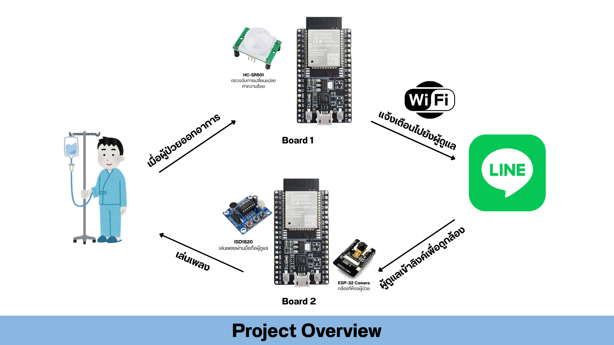
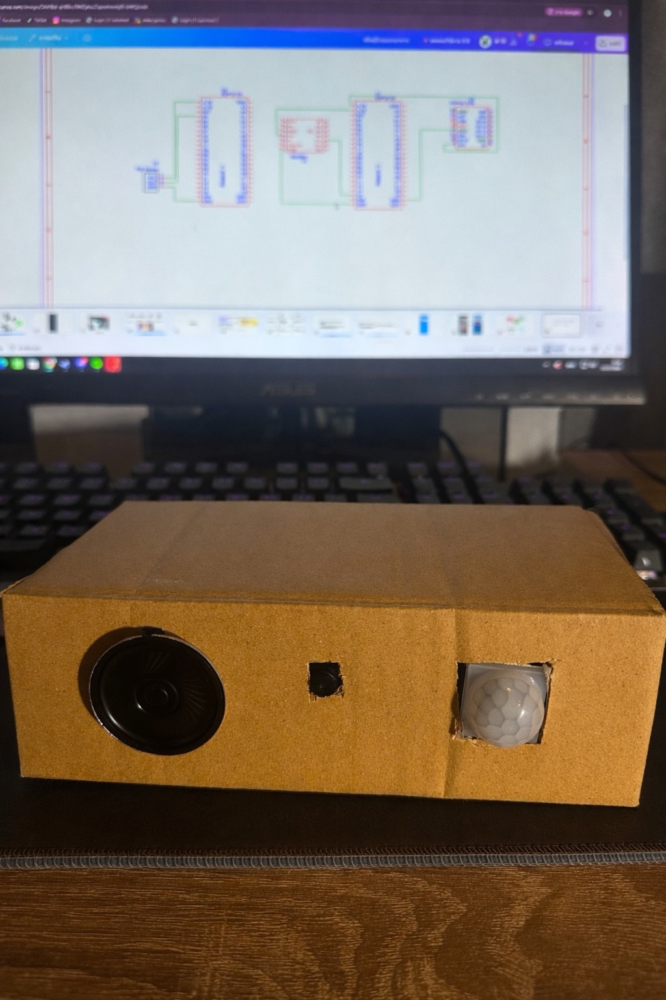
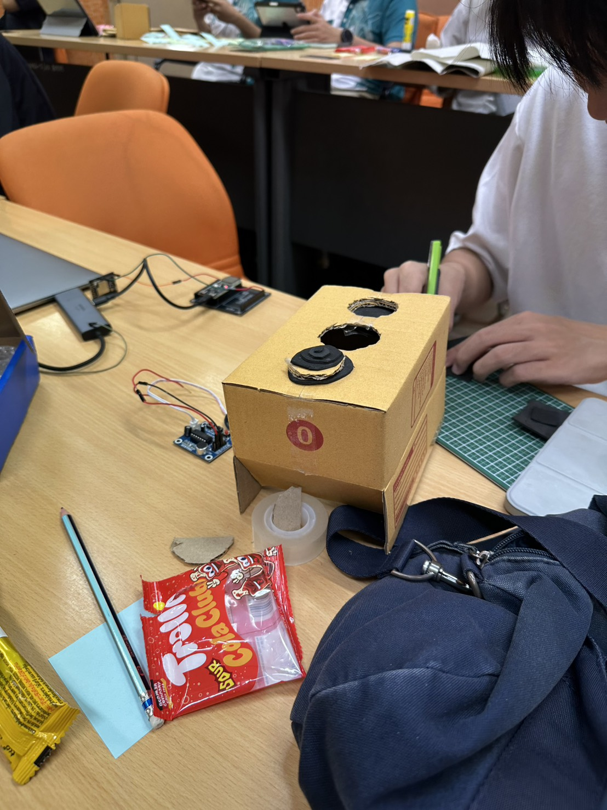
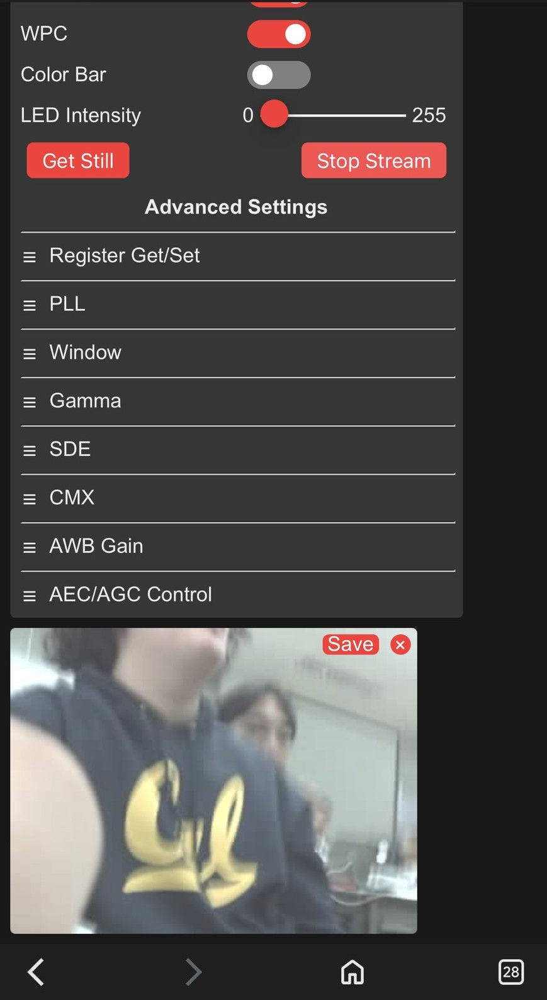

# ESP32-Based Patient Monitoring System

**University Team Project** — an educational hardware prototype designed to assist caregivers in monitoring patients with Alzheimer's disease through movement alerts, camera monitoring, and recorded audio. This is a course prototype, not a medical-grade or production-ready device.

## Project Overview

The prototype explores how connected hardware can help a caregiver notice movement and check the surrounding environment. A PIR sensor provides movement input to an ESP32, which sends caregiver notifications through LINE. Separate firmware supports ESP32 camera monitoring and browser-based control of an ISD1820 voice/audio module.

The repository contains firmware for these three functions, a PCB design export, and development photos. The functions are represented by separate programs rather than a single combined firmware application.

## System Workflow

1. The PIR firmware connects to Wi-Fi and synchronizes time using NTP.
2. When movement is detected and the alert interval has elapsed, it sends a timestamped message through the LINE Messaging API and requests an IFTTT webhook.
3. The camera firmware initializes the camera, connects to Wi-Fi, and calls a camera web server for monitoring. Supporting server source files are currently missing.
4. The voice-control firmware serves a web page with playback and recording controls, driving the audio module through GPIO outputs.

## Hardware

- ESP32 development boards for movement detection and audio control.
- ESP32 camera board for visual monitoring.
- HC-SR501 PIR movement sensor, identified in the system overview.
- ISD1820 recording/playback module and speaker, supported by the overview and prototype photos.
- Wiring and a prototype enclosure, shown in the gallery.

Exact board variants and final wiring should be confirmed before reproducing the prototype.

## Software & Technologies

- Arduino-style C++ firmware for ESP32.
- ESP32 Wi-Fi, `HTTPClient`, `WiFiClientSecure`, and `WebServer` libraries.
- ESP32 camera API (`esp_camera.h`).
- LINE Messaging API with JSON messages and an IFTTT webhook request.
- NTP time synchronization and Thai date/time formatting.
- HTML browser controls for audio playback and recording.

## Firmware Structure

| Folder | Source | Purpose |
| --- | --- | --- |
| `firmware/pir-alert/` | [Board_PIR_SPEAKER.c](firmware/pir-alert/Board_PIR_SPEAKER.c) | Reads PIR input, sends LINE alerts, and triggers an IFTTT webhook. |
| `firmware/camera-stream/` | [BOARD_ESPCAMERA32.c](firmware/camera-stream/BOARD_ESPCAMERA32.c) | Initializes the camera and starts the camera-server entry point. |
| `firmware/voice-control/` | [voice_control.ino](firmware/voice-control/voice_control.ino) | Provides a web interface for GPIO-controlled audio playback and recording. |

## Hardware Design

The PCB design export is available at [hardware/esp32_patient_monitor_pcb.json](hardware/esp32_patient_monitor_pcb.json). It preserves the board layout for review; this repository does not establish fabrication readiness or include a verified assembly procedure.

## Project Gallery

**Prototype enclosure**

**Development and assembly**

**LINE alert screenshot**

**Camera monitoring screenshot**

## Security / Configuration

Copy [config.example.h](config.example.h) to a local `config.h` at the repository root, then fill in the settings required by each firmware program. The example contains placeholders for board Wi-Fi settings, LINE credentials, and IFTTT configuration. Firmware includes this local header through `../../config.h`.

`config.h` is ignored by [.gitignore](.gitignore) and must remain private. Never put actual credentials in the example or firmware sources. Review photos and screenshots for personal or network information before publishing them.

## Limitations

- This educational prototype is not a substitute for caregiver supervision and has no documented clinical validation or measured reliability results.
- PIR detection has limited range and can miss movement or produce false alerts; detection range and error rates have not been measured in this repository. Movement information alone cannot determine a patient's medical condition. The firmware does not identify a patient, recognize falls, or diagnose a medical condition.
- Camera `board_config.h` and the implementations of `startCameraServer()` and `setupLedFlash()` are absent. The camera firmware cannot be built from the current source files alone.
- Compilation has not been verified. The two `.c` files contain C++ constructs and require appropriate Arduino/C++ packaging. No pinned toolchain, dependency versions, or verified build instructions are supplied; the ESP32 Arduino core and camera support are required.
- Network initialization can block while waiting for Wi-Fi or time synchronization. Notification delivery depends on network access and external service configuration; no retry queue is implemented.
- The LINE HTTPS client disables certificate verification, and the audio web interface has no authentication. Additional security work is required before deployment beyond a controlled demonstration network.
- Gallery images document demonstrations, not performance tests or proof of a reproducible build.

## Future Improvements

Future work could include restoring missing camera sources, documenting board selection and wiring, and providing a reproducible build setup. Other improvements include verified TLS connections, authenticated audio controls, connection timeouts and notification retries, and documented testing of movement detection and end-to-end alerts.

## Project Context

Developed as a **university team project** for an introductory computer hardware development course. The work combines embedded programming, hardware integration, PCB design, and prototype assembly around an Alzheimer's caregiving use case. The repository presents the team's project artifacts and does not assign individual contributions.
